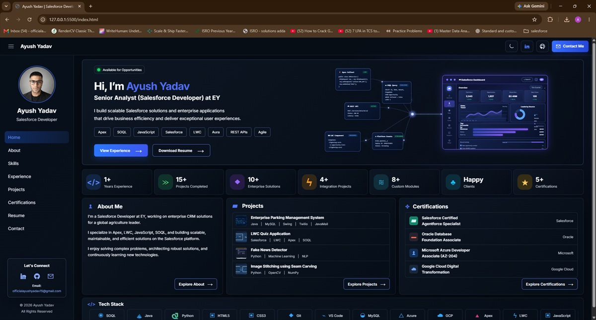

# Ayush Yadav — Developer Portfolio

A static, multi-page portfolio presenting Ayush Yadav’s Salesforce development profile, skills, experience, projects, certifications, résumé, and contact information. The site uses HTML, CSS, and browser JavaScript, with Netlify hosting and a server-side contact form integration.

- **Live portfolio:** [yadavayushportfolio.netlify.app](https://yadavayushportfolio.netlify.app)
- **Source repository:** [github.com/officialayushyadav15/developer-portfolio](https://github.com/officialayushyadav15/developer-portfolio)

## Visual preview

There is no dedicated, current full-page homepage screenshot in the repository. This is the existing portfolio project-card thumbnail; it is shown as a project asset, not as a full-site screenshot.



## Features

- Eight linked pages with shared header and sidebar components.
- Light and dark themes with the selected theme saved in browser storage.
- Responsive page styles and JavaScript-powered navigation transitions.
- Skills page content initialized from `IMAGES/data/skills.json` with an HTML fallback.
- Project cards with local thumbnail images and configured GitHub destinations.
- Résumé viewing and download links to the repository PDF.
- Contact form routed through a Netlify Function to Google Apps Script.
- Page-specific canonical URLs, Open Graph and Twitter/X metadata, homepage JSON-LD, `sitemap.xml`, and `robots.txt`.

## Technologies

| Technology | Use in this project |
| --- | --- |
| HTML, CSS, JavaScript | Page content, styling, responsive layouts, and browser behavior |
| JSON | Skills page data |
| Netlify | Static publishing and the contact serverless function |
| Node.js | Netlify Function runtime |
| Google Apps Script and Google Sheets | Contact processing and enquiry storage |
| Google Fonts (Inter) | Web typography |

There is no `package.json`, frontend framework, package manager, or automated test script in this repository. The function is in `netlify/functions/contact.js`; `netlify.toml` sets the publish directory to `.` and the function directory to `netlify/functions`.

## Portfolio pages

| Page | Path | Purpose |
| --- | --- | --- |
| Home | [`index.html`](index.html) | Introduction and portfolio overview |
| About | [`pages/about.html`](pages/about.html) | Personal and professional background |
| Skills | [`pages/skills.html`](pages/skills.html) | Technical skills and categories |
| Experience | [`pages/experience.html`](pages/experience.html) | Work experience |
| Projects | [`pages/projects.html`](pages/projects.html) | Project cards and repository links |
| Certifications | [`pages/certifications.html`](pages/certifications.html) | Certifications |
| Resume | [`pages/resume.html`](pages/resume.html) | Embedded résumé preview and download controls |
| Contact | [`pages/contact.html`](pages/contact.html) | Contact details and enquiry form |

## Selected projects

These repository links match the destinations configured for the project cards. The project page does not configure separate demo URLs.

- [Parkiva](https://github.com/officialayushyadav15/parking_management_system)
- [AuthentiScan — Fake News Detector](https://github.com/officialayushyadav15/fake-news-detector)
- [Image Stitching using Seam Carving](https://github.com/officialayushyadav15/seam-carving)
- [Virtual Mouse](https://github.com/officialayushyadav15/virtual-mouse-using-hand-gesture)
- [Early Detection of Cardiovascular Disease](https://github.com/officialayushyadav15/early_cardio_vascular_disease_detection_system)
- [Portfolio Website source](https://github.com/officialayushyadav15/developer-portfolio)

## Project structure

```text
.
├── apps-script/Code.gs                 # Apps Script contact handler
├── components/                         # Shared header and sidebar markup
├── css/                                # Shared and page-specific stylesheets
├── IMAGES/
│   ├── data/skills.json                # Skills data
│   ├── project-thumbnails/             # Project card images
│   ├── LOGO.png
│   └── PROFILE.png
├── JS/                                 # Navigation, theme, skills, and form scripts
├── netlify/functions/contact.js        # Contact form proxy
├── pages/                              # Seven secondary HTML pages
├── RESUME/
│   └── Ayush_Yadav_Salesforce_Developer_Resume.pdf
├── .env.example                        # Local variable-name template
├── CONTACT_INTEGRATION.md              # Detailed contact setup and verification guide
├── index.html
├── netlify.toml
├── robots.txt
├── sitemap.xml
└── README.md
```

The `reference/` folder is local reference material excluded by `.gitignore`; it is not required for the site. Do not add local secrets or reference files to a deployment.

## Run locally on Windows

1. In PowerShell, clone the repository and open it in VS Code, or open an existing project folder. No VS Code extension is required by the project:

   ```powershell
   git clone https://github.com/officialayushyadav15/developer-portfolio.git
   cd developer-portfolio
   code .
   ```

2. To preview the static site, open a VS Code PowerShell terminal in the project root and start a local HTTP server (Python must be available):

   ```powershell
   py -m http.server 8000
   ```

   Open [http://localhost:8000](http://localhost:8000). A local HTTP server is needed for the shared header/sidebar and page navigation fetches; opening files directly with `file://` does not exercise those paths.
3. To run the Netlify Function locally, use Node.js and the Netlify CLI, then run `netlify dev` from the project root. The repository does not install or pin the CLI. Before testing the form, create a local `.env` from `.env.example` if needed and configure **test-only** Apps Script, spreadsheet, notification, and secret values. Do not overwrite an existing `.env` or use production resources for tests.

The static HTTP server previews pages only; it does not serve Netlify Functions. Netlify Dev serves the site and the function at `/.netlify/functions/contact`.

## Contact form architecture and configuration

The browser submits JSON to the same-origin Netlify Function. The function validates the configured origin and request, then forwards the request with its server-side shared secret to the Apps Script web app. Apps Script validates the request, records the enquiry in Google Sheets, and attempts an email notification. A saved enquiry and email delivery are separate outcomes; email is not guaranteed exactly once. The function’s in-memory rate limit is best-effort across serverless instances.

The function’s environment variable **names** are:

- `GOOGLE_APPS_SCRIPT_URL`
- `CONTACT_SHARED_SECRET`
- `CONTACT_ALLOWED_ORIGIN`

Apps Script separately uses these Script Property names: `SPREADSHEET_ID`, `SHEET_NAME`, `NOTIFICATION_EMAIL`, and `CONTACT_SHARED_SECRET`. Configure values privately for each environment; never put secrets in browser-delivered files or commit `.env`. For local development, use test resources. In production, set the function variables in the Netlify site’s environment variable settings and redeploy. The allowed origin must match the site origin exactly. See [`CONTACT_INTEGRATION.md`](CONTACT_INTEGRATION.md) for setup, retry behavior, safeguards, and a test checklist. A successful test submission writes data and may send email, so do not test against production resources casually.

## Résumé

The actual PDF is [`RESUME/Ayush_Yadav_Salesforce_Developer_Resume.pdf`](RESUME/Ayush_Yadav_Salesforce_Developer_Resume.pdf). The homepage links to it as a download; the Resume page offers download controls and opens the same PDF in its embedded preview.

## SEO files

- Each of the eight HTML documents has one self-referencing canonical URL for the production domain.
- Each page includes Open Graph and Twitter/X card metadata; the configured preview image is `IMAGES/PROFILE.png`.
- `index.html` contains WebSite and Person JSON-LD.
- Root `sitemap.xml` lists the eight page URLs, and `robots.txt` permits crawling and points to that sitemap.

These are source-code features; this README does not claim search indexing, ranking, or a measured SEO/performance score.

## Deploy with Netlify

The current `netlify.toml` publishes the repository root (`.`) and registers `netlify/functions` for functions. No frontend build command or dependency installation is configured.

1. In Netlify, connect the GitHub repository [`officialayushyadav15/developer-portfolio`](https://github.com/officialayushyadav15/developer-portfolio) to a site, or use the existing site’s configured Git connection.
2. Confirm the publish and function directories match `netlify.toml`.
3. Add the three function environment variables above in Netlify’s private environment settings, with function scope, and set the allowed origin to the deployed site’s exact origin. Configure Apps Script Script Properties separately.
4. Deploy the selected branch through the existing GitHub–Netlify workflow. Redeploy after changing environment settings.

The repository files describe the deployment configuration; the current Netlify dashboard settings and live form integration are not verified here.

## Author and links

**Ayush Yadav — Salesforce Developer**

- [GitHub profile](https://github.com/officialayushyadav15)
- [LinkedIn](https://www.linkedin.com/in/ayush-yadav-dev/)
- [Email](mailto:officialayushyadav15@gmail.com)

## License

No license file or reuse license is specified in the repository. Do not assume that the source or assets are licensed for reuse.
